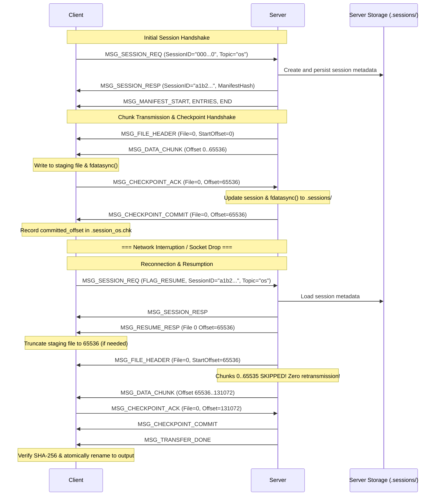

# IT305 Part II Case 2: Session Management & Checkpoint Resumption Protocol Specification

## 1. Overview & Architectural Principles

Case 2 specifies a stateful, fault-tolerant binary application protocol designed to deliver topic-based file bundles over TCP in unreliable network environments. Unlike Case 1 (which discards all progress and restarts from byte zero upon encountering a connection interruption), Case 2 introduces **durable session checkpoints**.

Key principles:
1. **Server Authoritative State**: The server persists active session state to disk (`.sessions/session_<id>.meta`) across crashes, restarts, and network disconnects.
2. **Chunk-Level Durability Handshake**: Every transmitted chunk requires explicit client durability confirmation (`MSG_CHECKPOINT_ACK`) followed by server commit confirmation (`MSG_CHECKPOINT_COMMIT`).
3. **Truncation Reconciliation**: If a failure occurs before a chunk is durably committed by both parties, the client truncates uncommitted bytes back to the server's authoritative offset on resume.
4. **Zero Retransmission of Committed Chunks**: Resumption skips all previously committed offsets, guaranteeing that payload bytes committed before a disruption are never transmitted again.

---

## 2. Fixed Binary Header Format (16 Bytes)

All protocol control messages and data frames share an identical 16-byte fixed-width header encoded in network byte order (big-endian):

```
 0                   1                   2                   3
 0 1 2 3 4 5 6 7 8 9 0 1 2 3 4 5 6 7 8 9 0 1 2 3 4 5 6 7 8 9 0 1
+-+-+-+-+-+-+-+-+-+-+-+-+-+-+-+-+-+-+-+-+-+-+-+-+-+-+-+-+-+-+-+-+
|          Magic (0x5446)       |    Version    |  Message Type |
+-+-+-+-+-+-+-+-+-+-+-+-+-+-+-+-+-+-+-+-+-+-+-+-+-+-+-+-+-+-+-+-+
|             Flags             |         Status / Error        |
+-+-+-+-+-+-+-+-+-+-+-+-+-+-+-+-+-+-+-+-+-+-+-+-+-+-+-+-+-+-+-+-+
|                         Payload Length                        |
+-+-+-+-+-+-+-+-+-+-+-+-+-+-+-+-+-+-+-+-+-+-+-+-+-+-+-+-+-+-+-+-+
|                        Sequence Number                        |
+-+-+-+-+-+-+-+-+-+-+-+-+-+-+-+-+-+-+-+-+-+-+-+-+-+-+-+-+-+-+-+-+
```

### Field Definitions:
- **Magic** (`uint16_t`, 2 bytes): Constant `0x5446` (ASCII `'TF'` for TopicFile). Messages with mismatched magic are immediately rejected with `ERR_PROTOCOL`.
- **Version** (`uint8_t`, 1 byte): Protocol version, set to `2`.
- **Message Type** (`uint8_t`, 1 byte): Identifies the frame purpose.
- **Flags** (`uint16_t`, 2 bytes): Bitmask:
  - `0x0001` (`FLAG_EOF_FILE`): Last chunk of the current file.
  - `0x0002` (`FLAG_RESUME`): Client is requesting to resume an existing session.
- **Status / Error Code** (`uint16_t`, 2 bytes): `0` for success (`ERR_OK`), or error code.
- **Payload Length** (`uint32_t`, 4 bytes): Size in bytes of following message body ($0 \le \text{len} \le 65536$).
- **Sequence Number** (`uint32_t`, 4 bytes): Monotonically increasing per-connection sequence number.

---

## 3. Message Types

| Value | Identifier | Direction | Description |
|---|---|---|---|
| `0x10` | `MSG_SESSION_REQ` | Client $\to$ Server | Initiate new session or request resume with 32-hex Session ID |
| `0x11` | `MSG_SESSION_RESP` | Server $\to$ Client | Accept session request with Session ID & topic manifest digest |
| `0x12` | `MSG_RESUME_RESP` | Server $\to$ Client | Authoritative committed offsets for all files in resumed session |
| `0x03` | `MSG_MANIFEST_START` | Server $\to$ Client | Announce topic file count and total size |
| `0x04` | `MSG_MANIFEST_ENTRY` | Server $\to$ Client | Individual file catalog item (index, size, SHA-256, filename) |
| `0x05` | `MSG_MANIFEST_END` | Server $\to$ Client | End of catalog transmission |
| `0x06` | `MSG_FILE_HEADER` | Server $\to$ Client | Signal start of file streaming with authoritative start offset |
| `0x07` | `MSG_DATA_CHUNK` | Server $\to$ Client | Payload block (up to 64 KB) |
| `0x13` | `MSG_CHECKPOINT_ACK` | Client $\to$ Server | Client confirms chunk written and `fdatasync`ed to disk |
| `0x14` | `MSG_CHECKPOINT_COMMIT` | Server $\to$ Client | Server confirms durable commit to `.sessions/` |
| `0x08` | `MSG_TRANSFER_DONE` | Server $\to$ Client | Entire topic transfer complete |
| `0xFF` | `MSG_ERROR` | Either $\to$ Other | Fatal error report |

---

## 4. Message Payloads

### 4.1 `MSG_SESSION_REQ` (Client $\to$ Server)
```
+--------------------------------+--------------------+----------------------+
| Session ID (32 bytes ASCII)   | Topic Len (2 bytes)| Topic Name (variable)|
+--------------------------------+--------------------+----------------------+
```
- For fresh session: Session ID is filled with 32 `'0'` characters, `Flags = 0x0000`.
- For resume: Session ID contains saved 32-hex ID, `Flags = FLAG_RESUME (0x0001)`.

### 4.2 `MSG_SESSION_RESP` (Server $\to$ Client)
```
+--------------------------------+--------------------+--------------------+-----------------------+
| Session ID (32 bytes ASCII)   | Status (4 bytes)   | Total Files (4 B)  | Manifest Hash (32 B)  |
+--------------------------------+--------------------+--------------------+-----------------------+
```

### 4.3 `MSG_RESUME_RESP` (Server $\to$ Client)
```
+-------------------+------------------+---------------------+-------------------+---------------------+
| Session ID (32 B) | Status (4 bytes) | Manifest Hash (32 B)| Total Files (4 B) | Offsets (N * 8 B)   |
+-------------------+------------------+---------------------+-------------------+---------------------+
```
- Each 8-byte entry in `Offsets` gives the authoritative committed byte offset for file index $i$.

### 4.4 `MSG_CHECKPOINT_ACK` (Client $\to$ Server)
```
+--------------------------------+----------------------+-----------------------------+
| Session ID (32 bytes ASCII)   | File Index (4 bytes) | Committed Offset (8 bytes)  |
+--------------------------------+----------------------+-----------------------------+
```

### 4.5 `MSG_CHECKPOINT_COMMIT` (Server $\to$ Client)
```
+--------------------------------+----------------------+-----------------------------+
| Session ID (32 bytes ASCII)   | File Index (4 bytes) | Committed Offset (8 bytes)  |
+--------------------------------+----------------------+-----------------------------+
```

---

## 5. Lifecycle Sequence Diagram


